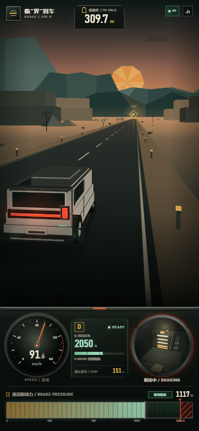
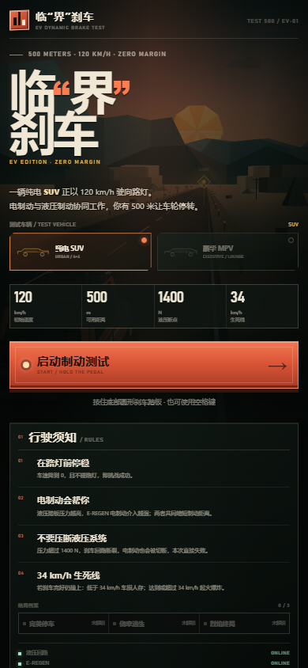
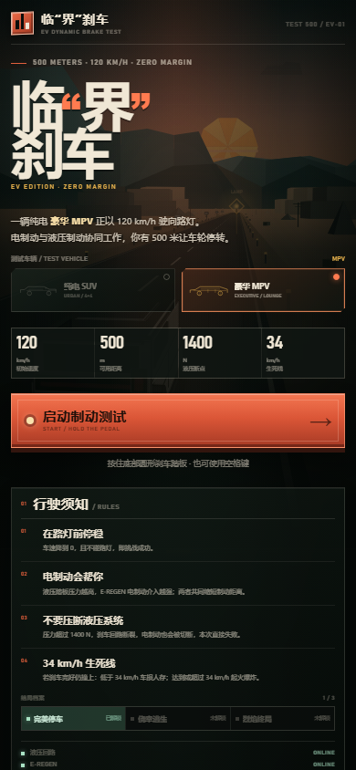
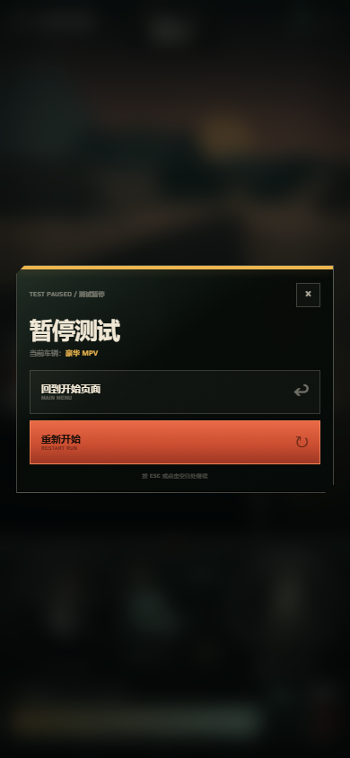
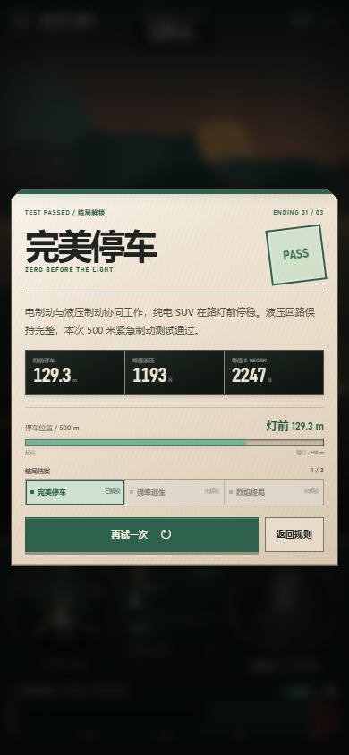

# 临“界”刹车 · EV BRAKE TEST

移动端优先的低多边形 3D 紧急制动小游戏。驾驶一辆纯电 SUV，在 120 km/h、500 米死亡距离内，靠**液压制动 + E‑REGEN 电制动**把车停在路灯前。



## 玩法

- 开始前先选测试车：**纯电 SUV** 或**豪华 MPV**；选择会记住，两台车共用同一套液压 + E‑REGEN 制动系统。
- **按住**右下角圆形 3D 刹车踏板（或 `Space` / `↓`）升压；松开回弹。
- 踏板前段升压快，后段越来越慢：想达到 1000 N 以上需要连续按住更久，不能靠一瞬间猛踩。
- 液压压力持续上升：约 **900–1300 N** 为有效制动区；超过 **1400 N** 会压断液压回路。
- 电制动会随液压压力与车速一起介入，所以液压不必踩到 900 N 以上也能停住。
- 游戏左上角的菜单按钮或 `Esc` 会暂停测试，可回到开始页面或重新开始；按 `Esc` 或点击空白处继续。
- 三种结局：
  - **完美停车**：在路灯前速度归零。
  - **侥幸逃生**：撞上灯柱，但撞击速度低于 **34 km/h**。
  - **烈焰终局**：撞击速度 ≥ 34 km/h，或液压回路被压断后撞击。
- 结局会保存在浏览器 `localStorage` 中，重开页面仍会记录。







## 为什么 500 米内停得住？

120 km/h = 33.33 m/s。要在 500 m 内从 120 静止，平均减速度至少需要：

```text
a = v² / (2s) = 33.33² / (2 × 500) = 1.111 m/s²
```

整车质量按 1600 kg 计，平均需要约 **1778 N** 的总阻力；地面滚动阻力系数取 **μ=0.008**，约 **126 N**，平均车速 60 km/h 时空气阻力约 **61 N**，所以制动系统平均需提供约 **1591 N**。

液压回路的安全上限是 1400 N，单独靠液压**不够**；这正是纯电 SUV 的 E‑REGEN 要补上的部分。游戏里的电制动最高可贡献约 3600 N，并且液压越大、车速越高，回收制动力越强。

地面滚动阻力会让车辆在松开踏板后自然、轻微地减速；仪表盘显示到 **0.1 km/h**，因此这种缓慢变化是可见的。以 120 km/h 松踏板滑行约 3 秒，车速大约会从 120.0 降到 117.5 km/h。

踏板升压使用曲线：

```text
dP/dt = 760 × (0.11 + 0.89 × e^(-t / 1.0)) N/s
```

刚开始约 760 N/s，前段升压非常快；之后逐渐衰减到约 84 N/s，这就是“前快后慢”。按住约 1 秒约 511 N、2 秒约 752 N、3 秒约 894 N。需要更早开始制动，并在最后一段耐心保持。

模拟结果（持续踩住固定压力，含建压过程）：

| 液压压力 | 结果 |
| --- | --- |
| 约 725 N | 以约 28.7 km/h 撞上灯柱 → 侥幸逃生 |
| 约 750 N | 以约 18.6 km/h 撞上灯柱 → 侥幸逃生 |
| 约 775 N | 刚好在路灯前停住 |
| 约 1100 N | 提前约 165 m 停稳 |
| 不制动 | 约 107.7 km/h 撞击 |
| >1400 N 持续保持 | 液压断裂、电制动切断，无法减速 → 烈焰终局 |

游戏内同时显示液压压力、E‑REGEN 实时贡献和**预计停车距离**，可以边踩边判断是否会在 500 m 内停住。

## 运行

不需要构建、不需要安装依赖、不请求外部网络：

- 直接双击打开 `index.html`，或
- 在目录内启动静态文件服务器，并允许局域网访问：

```bash
python -m http.server 8765 --bind 0.0.0.0
```

电脑本机访问 <http://127.0.0.1:8765/>。

### 手机怎么玩

如果手机和电脑在**同一个 Wi‑Fi**，把下面的局域网地址发到手机浏览器即可：

**<http://192.168.2.120:8765/>**

这是电脑当前的局域网 IPv4，路由器重新分配地址后可能变化。手机用流量、或不在同一个 Wi‑Fi 时无法访问这个地址；它不是公网链接。

如果手机打不开，说明 Windows 防火墙拦住了入站连接：右键点击 `allow-phone-access.bat`，选择“以管理员身份运行”，它会放行专用网络下的 TCP 8765。也可以手动在 Windows 防火墙中允许 Python（专用网络）或允许 TCP 8765 入站。

这是移动端竖屏优先设计，兼容 320–430 px 宽度；桌面端会以居中仪表台窗口显示。支持触控按住、鼠标按住、空格 / 方向键。

## 视觉与技术

- 场景不是贴图或平面透视：`engine3d.js` 是一个无依赖的 Canvas 2D 软件 3D 渲染器，使用低多边形盒体、棱柱、圆柱、透视相机、平面着色、雾、边缘线和屏幕空间光晕绘制。
- 车辆、路灯、山脉、公路、落日与圆形驾驶舱踏板视图全部实时 3D 渲染。
- 两套车辆模型：橙黑配色的纯电 SUV，以及珍珠白车身、黑色车顶、镀铬饰条的豪华 MPV；选择后会出现在追车场景中。
- 仪表台为汽车式圆形速度表 + EV 能量/电制动信息屏 + 底部液压压力条；速度精确到 0.1 km/h，底部压力条保留进度条交互。
- 地面滚动阻力 μ=0.008；不踩刹车时速度会非常缓慢地自然下降。
- 左上角菜单按钮 / `Esc` 暂停菜单；暂停时物理、倒计时与碰撞计时全部冻结。
- 音效由 WebAudio 实时合成，可关闭。

## 文件

```
index.html        页面结构、HUD、车辆选择与暂停菜单
styles.css        移动端仪表台 / 开场 / 暂停 / 结果样式
engine3d.js       无依赖 3D 渲染内核
world.js          公路场景、SUV / MPV、路灯、踏板视图
game.js           输入、升压曲线、物理、车辆选择、暂停、结局流程
screenshots/      预览图
```


